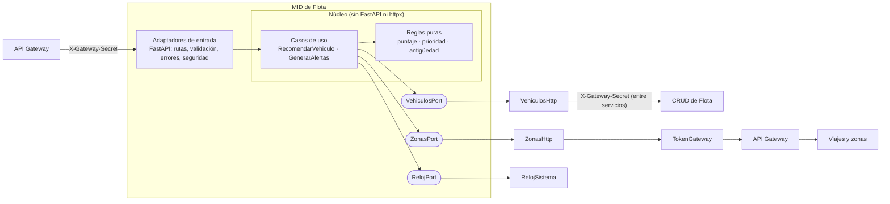

# API Flota MID: recomendaciones y alertas

MID (capa de lógica de negocio) del grupo **Flota** del clúster Rodar. No guarda datos propios: combina el **CRUD de Flota** (los vehículos) con las **zonas de Viajes y zonas** para recomendar vehículos y generar alertas operativas.

| | |
| --- | --- |
| **Lenguaje y framework** | Python 3.12 y FastAPI |
| **Arquitectura** | Hexagonal (puertos y adaptadores): ver más abajo y la página «Hexagonal - Flota» de `Proyecto Rodar.drawio` |
| **Dependencias** | [uv](https://docs.astral.sh/uv/) (`pyproject.toml` y `uv.lock`) |
| **Contrato** | [`docs/openapi.json`](docs/openapi.json) (alcances y errores declarados) |
| **Todo corre en Docker** | No hace falta instalar Python, uv ni los demás servicios |

## Documentación

| Para | Documento |
| --- | --- |
| **Consumir el MID** (otros equipos): rutas del gateway, alcances, ejemplos, errores | [docs/integracion.md](docs/integracion.md) |
| Qué falta por hacer (para el equipo de Flota) | [PENDIENTES.md](PENDIENTES.md) |
| Cambios por versión | [CHANGELOG.md](CHANGELOG.md) |

## Qué hace

| Endpoint | Qué hace |
| --- | --- |
| `GET /recomendaciones/vehiculo?lat&lng&tipo` | Los 3 mejores vehículos a 500 m o menos: `disponible`, batería de al menos 25 %, fuera de zonas prohibidas, ordenados por `puntaje = distancia - batería × 2`. `200` con lista vacía y `motivo` si no hay; `503` si Viajes y zonas no responde |
| `GET /flota/alertas` | Vehículos que requieren atención: batería menor a 15 %, zona prohibida o más de 2 h sin actualizar; una alerta por condición, ordenadas por prioridad y luego por antigüedad. Si Viajes y zonas no responde, **degrada** (advertencia `zonas_no_verificadas`) |
| `GET /health` | Estado del servicio (público) |

Las decisiones que el enunciado no fija (una alerta por condición, solo vehículos `disponible`, degradar en las alertas) están justificadas en [PENDIENTES.md](PENDIENTES.md) para que el grupo las confirme.

## Arquitectura hexagonal



El núcleo solo conoce los **puertos** (interfaces). Qué hay detrás lo deciden los adaptadores: en producción, HTTP; en las pruebas, simulados. Por eso las reglas se prueban sin red.

| Carpeta | Contenido |
| --- | --- |
| `app/dominio/` | **Núcleo**: modelos, puertos, reglas puras y los dos casos de uso. No importa FastAPI ni httpx |
| `app/adaptadores/entrada/` | API HTTP: rutas, esquemas, errores, seguridad (`X-Gateway-Secret`), alcances del contrato |
| `app/adaptadores/salida/` | Clientes: CRUD de Flota, Viajes y zonas por el gateway, token del gateway, reloj |
| `app/config.py`, `app/main.py` | Configuración y composición (`crear_app` acepta puertos simulados) |
| `simuladores/` | Simulador del CRUD de Flota, de Viajes y zonas y del token del gateway (solo desarrollo y pruebas) |
| `tests/` | 148 pruebas |

## Cómo se conecta con los demás servicios

| Conexión | Cómo | Configuración |
| --- | --- | --- |
| Gateway → MID | El gateway agrega `X-Gateway-Secret`; el MID responde `401` sin ella | `GATEWAY_SECRET` |
| MID → CRUD de Flota | Directo, entre servicios, enviando el secreto **del CRUD** | `FLOTA_CRUD_URL`, `FLOTA_CRUD_SECRET` |
| MID → Viajes y zonas | **Siempre por el gateway**, con el token de este MID (OAuth2 *client credentials*, se guarda y se renueva solo) | `GATEWAY_URL`, `CLIENT_ID`, `CLIENT_SECRET` |

## Ejecución

```bash
make up          # el MID en http://localhost:8100 con el simulador de los servicios de los que depende
curl -H "X-Gateway-Secret: cambiar-este-secreto" "localhost:8100/recomendaciones/vehiculo?lat=4.711&lng=-74.0721"
curl -H "X-Gateway-Secret: cambiar-este-secreto" "localhost:8100/flota/alertas"
make down
```

Sin `.env`, el MID apunta al simulador (`docker compose --profile simulado`). Para apuntar a los servicios reales, copie `.env.example` a `.env` y complete las URLs y los secretos; sin el perfil `simulado` no se levanta el simulador. El simulador devuelve lo mismo que los servicios reales con los datos semilla de Flota (se comprobó contra el CRUD real).

## Pruebas

```bash
make test        # docker compose --profile test run --rm --build test
```

148 pruebas, todas **sin red**: las reglas con dobles de los puertos; los adaptadores con `httpx.MockTransport` (reintentos, token, paginación, 401); la API completa; y el MID de punta a punta contra el simulador (recomendación, alertas, caídas de cada servicio, credenciales equivocadas). Otras pruebas fallan si `docs/openapi.json` o la guía se desactualizan.

## Configuración

Ver [`.env.example`](.env.example). Los secretos y las URLs no tienen valor por defecto en la aplicación: si faltan, no arranca.

| Variable | Por defecto | Qué hace |
| --- | --- | --- |
| `GATEWAY_SECRET` | — | Secreto que el gateway envía al MID |
| `FLOTA_CRUD_URL`, `FLOTA_CRUD_SECRET` | — | CRUD de Flota y su secreto |
| `GATEWAY_URL`, `CLIENT_ID`, `CLIENT_SECRET` | — | Gateway y credenciales de este MID |
| `GATEWAY_TOKEN_URL` | `GATEWAY_URL` + `/token` | Ruta del token |
| `TOKEN_SCOPE` | `zonas:leer` | Alcance que se pide al gateway |
| `ZONAS_RUTA` | `/viajes/zonas/verificar` | Ruta de Viajes y zonas, detrás del gateway |
| `RADIO_BUSQUEDA_M` | `500` | Radio de búsqueda |
| `BATERIA_MINIMA` | `25` | Por debajo no se recomienda |
| `MAX_RECOMENDACIONES` | `3` | Cantidad de recomendaciones |
| `BATERIA_ALERTA`, `BATERIA_ALERTA_ALTA` | `15`, `10` | Umbrales de las alertas |
| `HORAS_SIN_ACTUALIZAR` | `2` | Inactividad que genera alerta |
| `ESTADOS_ALERTA` | `disponible` | Estados que se evalúan, separados por coma |
| `EXTERNOS_TIMEOUT_S`, `EXTERNOS_REINTENTOS`, `EXTERNOS_BACKOFF_S` | `3`, `2`, `0.2` | Espera máxima, reintentos y espera inicial entre intentos |
| `CONCURRENCIA_ZONAS` | `10` | Consultas simultáneas a Viajes y zonas |
| `MAX_PAGINAS` | `10` | Páginas máximas al leer el CRUD (100 vehículos por página) |

## Metodología

Git flow con microcommits: `main` (versiones), `develop` (integración) y una rama `feature/*` por bloque de trabajo, fusionada a `develop` con `--no-ff`. Todo corre en Docker; las dependencias se manejan con uv (`make add pkg=...`, `make lock`). Cuando cambie el contrato: `make openapi`.

## Aportes de cada integrante

_Pendiente: completar con el nombre de cada integrante y su aporte._
